<!-- GitHub profile README for https://github.com/itsSwArchitect -->
<!-- This design intentionally avoids external stats cards and scheduled snake workflows. -->

  

  <h3>Senior OpenShift & Cloud Administrator · Platform Engineering · DevOps · Applied AI</h3>

  

    <strong>6+ years in software and infrastructure engineering</strong> 
    Building secure, observable, resilient platforms for enterprise workloads.
  

  

    <a href="https://github.com/itsSwArchitect">GitHub</a>
    &nbsp;•&nbsp;
    <a href="https://www.linkedin.com/in/abid-ali-45659716a/">LinkedIn</a>
    &nbsp;•&nbsp;
    <a href="mailto:programmercu@gmail.com">Email</a>
    &nbsp;•&nbsp;
    <a href="https://doi.org/10.1007/s00521-024-10857-0">Research publication</a>
  

---

### 👋 About me

I'm **Abid Ali**, a software engineer turned cloud-native infrastructure and platform engineer, with a research background in **machine learning, NLP, and transfer learning**.

I work across the layers that make applications dependable: from **Red Hat OpenShift and Kubernetes** to **virtualization, storage, automation, networking, observability, and disaster recovery**. My experience includes supporting business-critical workloads in enterprise environments, including banking infrastructure.

> **My focus:** Engineer platforms that are reliable in production, secure by design, and simple for teams to operate.

### 🚀 What I bring to the table

| Focus area | Experience |
| :--- | :--- |
| ☸️ **Cloud-native platforms** | OpenShift / Kubernetes administration, Operators, cluster networking, ingress, storage, workload lifecycle, and high availability. |
| ⚙️ **Platform automation** | Terraform, Ansible, Helm, GitLab CI/CD, Jenkins, Argo CD, container delivery, and repeatable operations. |
| 🖥️ **Virtualization & infrastructure** | OpenShift Virtualization, VMware vSphere / ESXi / vCenter, Linux / RHEL, enterprise compute, and storage integration. |
| 🔁 **Reliability & disaster recovery** | High-availability design, backup and restoration workflows, replication, DR readiness, and operational troubleshooting. |
| 📊 **Observability & operations** | Prometheus, Grafana, Thanos, Alertmanager, metrics, alert routing, dashboards, and incident-oriented monitoring. |
| 🔐 **Platform security** | Workload isolation, secrets management research, infrastructure hardening, access boundaries, and zero-trust design concepts. |
| 🧠 **AI & research** | NLP, transfer learning, PyTorch, TensorFlow, scikit-learn, and practical interest in local LLM deployment. |

### 🧰 Technical toolbox

| Domain | Technologies |
| :--- | :--- |
| **Containers & orchestration** | `Red Hat OpenShift` `Kubernetes` `OpenShift Virtualization` `Docker` `Podman` `Helm` `Operators` |
| **Automation & delivery** | `Ansible` `Terraform` `GitLab CI/CD` `Jenkins` `Argo CD` `Git` `Bash` |
| **Operating systems & cloud** | `RHEL` `Linux` `Microsoft Azure` `AWS` `Oracle Cloud` `Google Cloud` |
| **Virtualization & storage** | `VMware vSphere` `ESXi` `vCenter` `KubeVirt` `SAN` `NFS` `iSCSI` `Dell PowerStore` |
| **Networking & resilience** | `HAProxy` `DNS` `FortiGate` `VLANs` `Load Balancing` `High Availability` `Disaster Recovery` |
| **Observability** | `Prometheus` `Grafana` `Thanos` `Alertmanager` `Wazuh` |
| **Engineering & AI** | `Python` `Go` `Java` `PyTorch` `TensorFlow` `scikit-learn` `NLP` `LLMs` |

<strong>More of my software engineering background</strong>

 

Before focusing on infrastructure and cloud-native platforms, I worked on application and game development with **Java, Kotlin, Dart, Flutter, Android, and Unity**. That development background continues to shape how I approach developer experience, automation, and platform design.

### 🏗️ Selected engineering work

- **Enterprise OpenShift platforms** — Hands-on deployment and operation of container platforms for business-critical applications, including cluster networking, storage integration, ingress, and operational readiness.
- **Hybrid virtualization and DR** — VMware and OpenShift Virtualization, infrastructure integration, replication strategies, and availability planning across production and recovery environments.
- **Monitoring and alerting platforms** — Prometheus, Grafana, Thanos, and Alertmanager implementations focused on operational visibility and actionable alerts.
- **Zero-trust secrets for OpenShift (R&D)** — Exploring operator-based approaches to protect application secrets in shared clusters while preserving secure, reliable workload startup and recovery.

> Much of my enterprise infrastructure work is not public. I share architecture knowledge, lab work, and code where confidentiality permits.

### 📚 Published research

**[Author profiling from Romanized Urdu text using transfer learning models](https://doi.org/10.1007/s00521-024-10857-0)**  
*Neural Computing and Applications* (Springer), **2025** · First author

My research explores **transfer learning for NLP in Romanized Urdu**, connecting an academic interest in machine learning with practical engineering and AI systems.

### 🎓 Education & credentials

- **MSc, Computer Software Engineering** — research in NLP and transfer learning.
- **BS, Software Engineering**.

### 🔭 Current areas of interest

`AI , ML , LLM` · `OpenShift architecture` · `Platform security` · `Secrets protection` · `OpenShift Virtualization` · `Infrastructure automation` · `Resilient systems` · `Private / on-prem LLMs`

### 🤝 Let's connect

I'm interested in connecting with engineers and researchers working on **cloud-native platforms, DevOps, infrastructure resilience, Kubernetes security, and applied AI**.

**[LinkedIn](https://www.linkedin.com/in/abid-ali-45659716a/)** · **[Email](mailto:programmercu@gmail.com)** · **[GitHub](https://github.com/itsSwArchitect)**

  Build thoughtfully. Automate responsibly. Operate reliably.

